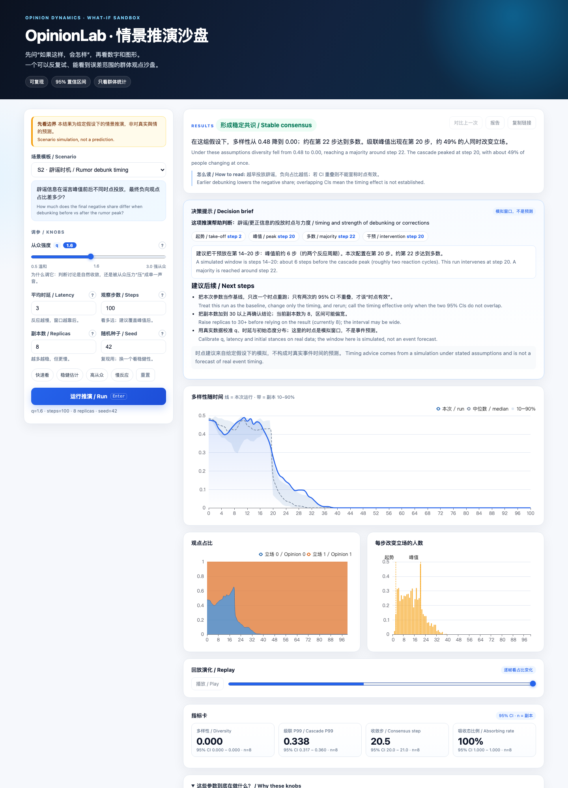

# OpinionLab · Scenario Sandbox

[](https://github.com/cxy2696/opinionlab/actions/workflows/ci.yml)
[](LICENSE)
[](pyproject.toml)

**中文** · [English](README_en.md) · [完整中文说明](README_cn.md)

**把“一群人会怎么想”变成可重复的实验。**
A sandbox for how opinions spread through groups — reproducible, with uncertainty ranges.



**在线体验 / Live demo:** https://cxy2696.github.io/opinionlab/

---

## 它是什么 / What it is

OpinionLab 用超图、非线性从众 `q` 和异质时延模拟群体观点演化。它输出带 95% 置信区间的情景范围，
以及“这个结果能支持什么判断”的说明，而不是单点预测。

OpinionLab simulates group opinion with hypergraphs, non-linear conformity `q` and heterogeneous
latency. It returns scenario ranges with 95% confidence intervals and a plain-language decision
brief — not a single-point forecast.

## 亮点 / Highlights

- **15 个中英双语模板**：危机沟通、社区议事、组织变革、产品发布、政策治理、学术复现
- **3D 工业操作舱**：星系背景、旋转舆情网络、目标锁定与遥测
- **3D 观测阵列**：观点地形、级联柱阵、立场粒子云，带读数、图例与悬浮值
- **参数解释**：每个参数都有“是什么/为什么调”、悬停提示与一键预置
- **决策提示**：关键时点、建议窗口、后续验证清单
- **可选本地 Ollama**：辅助解读，默认关闭，只解释不结论

## 30 秒上手 / 30-second start

```bash
git clone https://github.com/cxy2696/opinionlab.git
cd opinionlab
make demo        # http://127.0.0.1:8000
```

或直接打开在线版，无需安装：https://cxy2696.github.io/opinionlab/

```bash
make check       # ruff + mypy --strict + pytest
uv run python examples/rumor_timing.py --repeats 8
```

## 文档 / Documentation

| 中文 | English |
|---|---|
| [完整中文说明](README_cn.md) | [Full English README](README_en.md) |
| [使用场景](docs/USE_CASES_cn.md) | [Use cases](docs/USE_CASES_en.md) |
| [产品演示](docs/DEMO_cn.md) | [Demo](docs/DEMO_en.md) |
| [架构](docs/ARCHITECTURE_cn.md) | [Architecture](docs/ARCHITECTURE_en.md) |
| [数学模型](docs/MATH_MODEL_cn.md) | [Math model](docs/MATH_MODEL_en.md) |
| [模型卡](docs/MODEL_CARD_cn.md) | [Model card](docs/MODEL_CARD_en.md) |
| [合规](docs/COMPLIANCE_cn.md) | [Compliance](docs/COMPLIANCE_en.md) |
| [运维手册](docs/RUNBOOK_cn.md) | [Runbook](docs/RUNBOOK_en.md) |
| [容量报告](docs/capacity-report_cn.md) | [Capacity](docs/capacity-report_en.md) |
| [变更日志](CHANGELOG_cn.md) | [Changelog](CHANGELOG_en.md) |

## 仓库一览 / Repository at a glance

| 路径 | 说明 |
|---|---|
| `packages/hnle/` | 独立仿真引擎：模型、内核、指标、Monte Carlo、报告 |
| `apps/api/` | FastAPI 服务：登录、配额、作业、合规、演示 API |
| `apps/web/` | 本地演示前端源码；`site/` 构建时复用 |
| `scenarios/` | 15 个双语模板 |
| `tests/` | 单元、集成、金标、前端与文档测试 |
| `docs/` | 中英成对的数学、架构、合规、运维文档 |

## License

MIT
