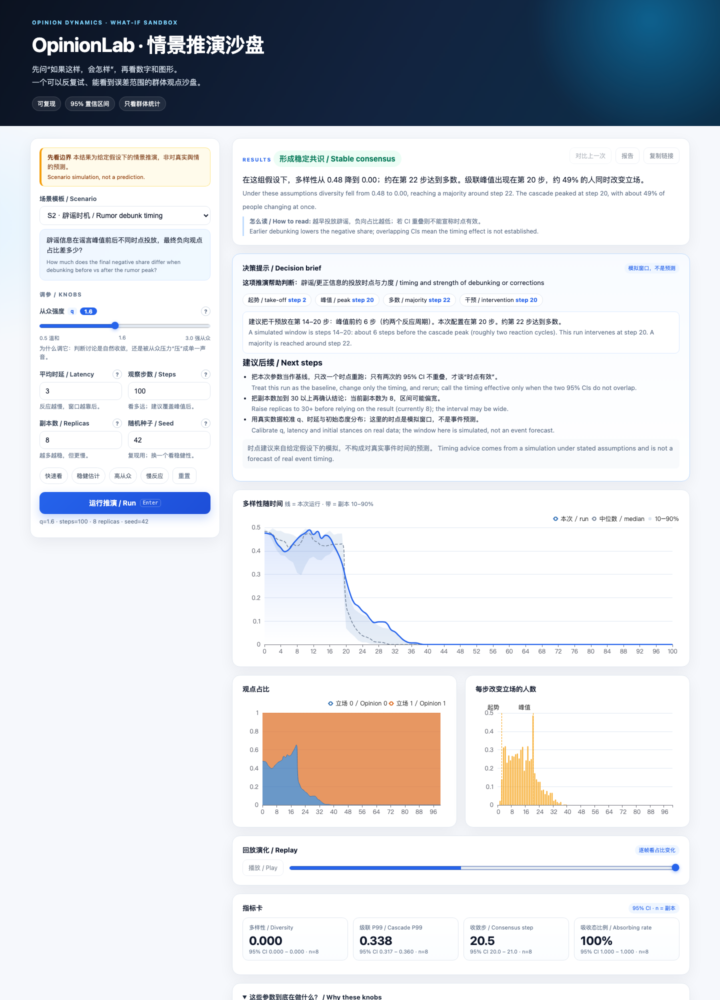
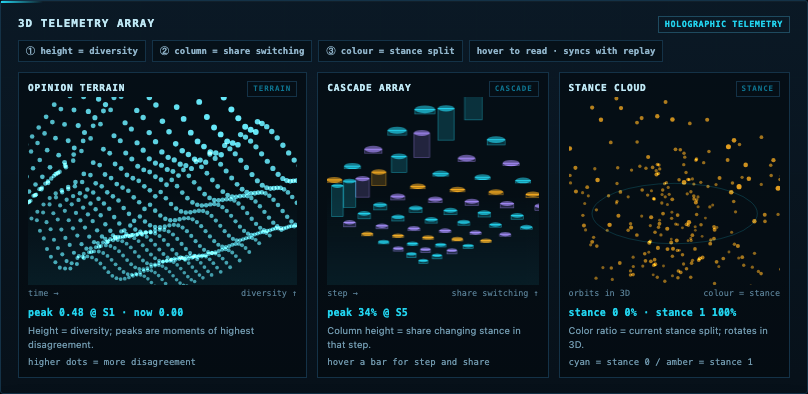

# OpinionLab · 舆情演化仿真沙盘

[](https://github.com/cxy2696/opinionlab/actions/workflows/ci.yml)
[](LICENSE)
[](pyproject.toml)

**中文** · [English](README_en.md) · [语言入口](README.md)

[中文](#中文) · [English](#english)

**把“一群人会怎么想”变成可以反复试验、能看到误差范围的沙盘。**
A sandbox for exploring how opinions spread through groups — reproducible, with uncertainty ranges instead of single numbers.

**在线试用 / Live demo:** https://cxy2696.github.io/opinionlab/





---

## 中文

### 它想解决什么问题

一条消息发出去，有人立刻转发，有人过两天才反应；小群体会互相强化，大群体会把少数声音盖过去。现实中的沟通、公关、社区治理和政策发布，常常只能“发完再看”。

OpinionLab 让你在发之前，先在沙盘里试：如果从众更强一点、如果反应更慢一点、如果早两天辟谣，群体的观点分布会怎么走？结果不是一个绝对数字，而是**一组带 95% 置信区间的可能范围**。

### 你可以用它做什么

- **危机沟通**：比较不同辟谣时点、不同降温力度下的负向占比与级联规模。
- **社区议事**：判断讨论是在形成共识，还是被从众压力压成“沉默的多数”。
- **组织变革**：试不同沟通节奏，观察员工情绪的反弹与回落。
- **新品发布**：区分“早期声量”与“长期口碑”，避免只看峰值。
- **教学与研究**：演示从众强度 `q` 如何改变共识速度；复现经典 Voter 模型极限。

每个场景在 [`docs/USE_CASES_en.md`](docs/USE_CASES_en.md).里都有具体问题、命令和“该看什么”。

### 5 分钟上手

**在线试用**（无需安装）：打开 https://cxy2696.github.io/opinionlab/

- **3D 观测阵列**：观点地形（点阵波面）、级联柱阵、立场粒子云，三块全动态 3D 视图
- 可选 **Ollama 本地辅助解读**：默认关闭，只把结果翻译成人话并建议下一步推演，不计算指标、不替代结论。界面采用 3D 工业追踪风格：旋转的舆情网络、目标锁定框、遥测与扫描线；右上角可一键切换中/英。每个参数都有“是什么/为什么调”的说明、悬停提示和一键预置（快速看 / 稳健估计 / 高从众 / 慢反应），不用先读文档。

**本地运行**（完整服务）：

```bash
git clone https://github.com/cxy2696/opinionlab.git
cd opinionlab
make demo        # 打开 http://127.0.0.1:8000
```

选一个模板，拖动 `q`，点“运行推演”。页面会显示多样性曲线、带 95% CI 的指标卡片；可以“对比上一次”，也可以下载单文件离线报告。

**命令行里跑**：

```bash
make setup
uv run hnle simulate --spec scenarios/s2_rumor_debunk_timing.yaml --repeats 20
uv run hnle report --run-id <run_id> --runs-dir runs
```

### 三个具体案例

1. **辟谣时点有没有用？**
   ```bash
   uv run python examples/rumor_timing.py --repeats 8
   ```
   对比 T+2 / T+12 / T+24 的最终正向占比。如果三组 CI 重叠，就不要对外说“越早越好”——在这组假设和样本量下，证据不足。

2. **社区讨论会不会被压成沉默？**
   ```bash
   uv run python examples/community_consensus.py --repeats 6
   ```
   把 `q` 从 1.0 调到 2.4。理想情况是收敛变快但多样性没有塌到 0；如果多样性迅速归零，说明讨论可能是被“压”下去的。

3. **学术复现**
   ```bash
   uv run hnle simulate --spec scenarios/g1_academic_reproduction.yaml --repeats 20
   ```
   在 `q=1`、二元超边、单位时延下，检查共识概率随人群规模的变化趋势。

更多案例见 [`docs/USE_CASES_en.md`](docs/USE_CASES_en.md).

### 它是怎么工作的

- **超图**：把“同一话题/同一群/同一场会议”里的人放在一条超边上，允许群体影响，而不只是两两对话。
- **两个旋钮**：从众强度 `q`（多容易跟随多数）和异质时延（每个人多久反应一次）。
- **可复现**：同一份配置 + 同一个种子，跑多少次结果都一样；每次运行都记录配置哈希、数据哈希和版本。
- **不确定性与护栏**：默认输出 95% CI；报告强制带免责声明；任何接口都不返回单个人的观点轨迹。

### 它不是什么

- 不是对真实舆情或个人立场的预测，也不做个体画像。
- 不模拟平台推荐算法、媒体议程和线下行为；这些需要另外的数据与模型。
- 参数估计得越粗，结论越只能当“方向性参考”。报告里会始终保留假设与局限。

### 模板库（15 个）

| 类别 | 模板 |
|---|---|
| 公共沟通 S1–S6 | 政策发布、辟谣时机、平台治理、品牌 KOL、应急科普、金融预期 |
| 通用场景 S7–S9 | 社区议事、组织变革、新品发布 |
| 研究与核查 G1–G7 | 学术复现、事实核查、公共卫生、平台系统性风险、灾害预警、企业变更；G5 选举类默认关闭，需用途审批 |

全部模板中英双语、可直接运行；`uv run hnle templates` 可列出。

### 仓库地图 / What lives where

| 路径 | 一句话说明 |
|---|---|
| `packages/hnle/` | 可独立运行的引擎：模型、超图、两种内核、指标、Monte Carlo、报告；不依赖数据库 |
| `apps/api/` | FastAPI 服务：登录/RBAC、配额、作业、连接器、合规、演示 API |
| `apps/web/` | 本地演示前端源码：HTML/CSS/JS、3D 场景、粒子、星系；数据来自 API |
| `site/` | GitHub Pages 站点：只保留站点专属文件，构建时从 `apps/web` 复制共享资源 |
| `scenarios/` | 15 个中英双语场景模板，直接可跑 |
| `examples/` | 两个最小可运行案例（辟谣时点、社区从众） |
| `tests/` | 单元、集成、金标与前端/文档测试 |
| `docs/` | 中英文成对的数学、架构、合规、运维、演示文档 |
| `benchmarks/` | 容量基准与 Locust 压测脚本 |
| `deploy/` | Compose、Helm（CN/Global）与离线交付 |
| `scripts/` | 静态站构建、场景模板导出 |
| `migrations/` | Alembic 数据库迁移 |

### 数学与可复现

模型定义、超边加权、`q` 的极限行为、时延语义、Monte Carlo 估计量与置信区间假设，都写在
[`docs/MATH_MODEL_cn.md`](docs/MATH_MODEL_cn.md)。文档里的每条公式都对应到具体代码函数，
并列出“哪些结论只能方向性使用”的边界。想先看结论，可以读
[`docs/MODEL_CARD_cn.md`](docs/MODEL_CARD_cn.md)。

### 常用命令

```bash
make demo    # 浏览器演示
make check   # ruff + mypy --strict + pytest
make bench   # 10 万节点基准（>90s 失败）
make migrate # 数据库迁移
```

### 文档

| 文档 | 内容 |
|---|---|
| [使用场景](docs/USE_CASES_cn.md) | 6 类真实问题、命令与解读 |
| [产品演示](docs/DEMO_cn.md) | 演示页、公开 API、限制 |
| [架构](docs/ARCHITECTURE_cn.md) | 分层、数据流、模块地图 |
| [数学模型](docs/MATH_MODEL_cn.md) | 公式与代码对应、采样 vs argmax |
| [模型卡](docs/MODEL_CARD_cn.md) | 能力、局限、禁止用途 |
| [合规说明](docs/COMPLIANCE_cn.md) | 双区、用途审批、删除与留存 |
| [运维手册](docs/RUNBOOK_cn.md) | 指标、日志、回滚、tainted |
| [容量报告](docs/capacity-report_cn.md) | 容量公式、实测系数、压测 |
| [CHANGELOG](CHANGELOG_cn.md) | 行为变更与已知偏差 |

### 部署

- 单机：`docker-compose.yml`（db / redis / minio / api / worker）
- 集群：`deploy/k8s/helm-cn` 与 `helm-global` 两套 values
- 私有化：`deploy/private/OFFLINE_cn.md`，无公网依赖

### License

MIT
