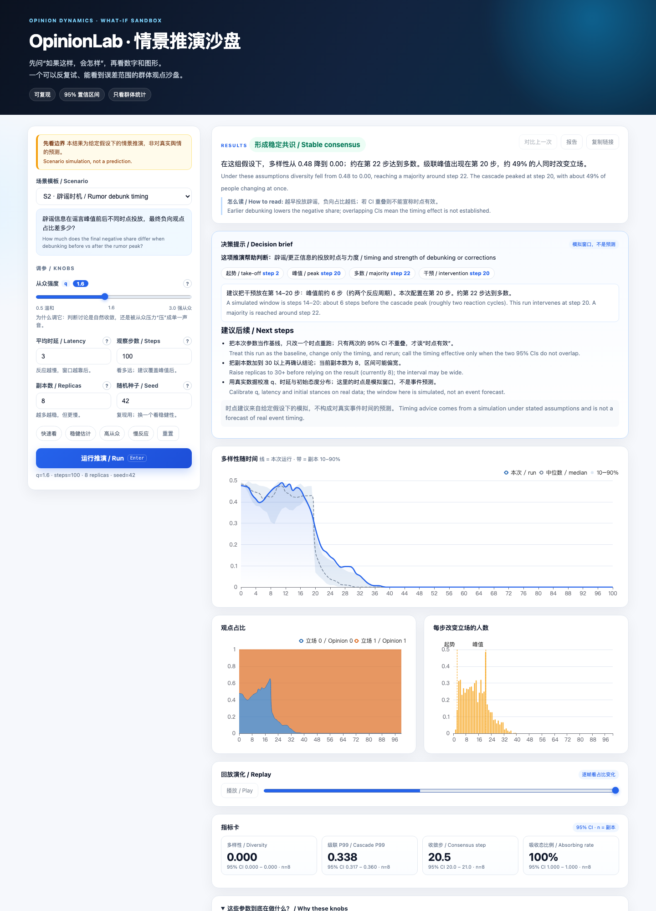
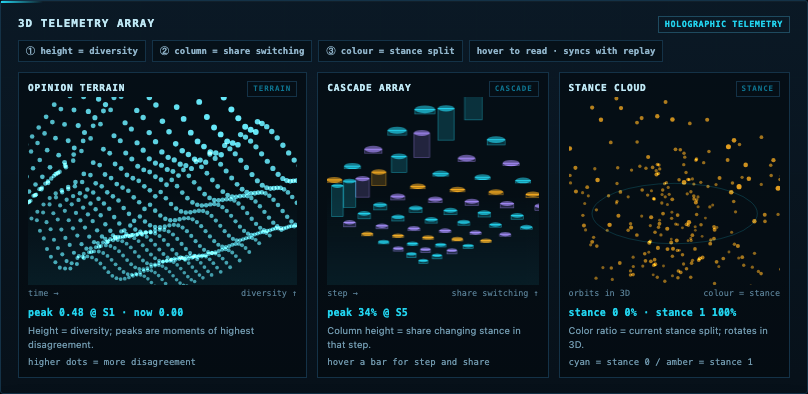

# OpinionLab · Scenario Sandbox

[](https://github.com/cxy2696/opinionlab/actions/workflows/ci.yml)
[](LICENSE)
[](pyproject.toml)

[中文](README_cn.md) · **English**

**Turn “how would this group react?” into an experiment you can repeat.**
A sandbox for how opinions spread through groups — reproducible, with uncertainty ranges instead of
single numbers.

**Live demo:** https://cxy2696.github.io/opinionlab/





## The problem

A message goes out. Some people share it immediately; others react two days later. Small groups
reinforce each other; large groups drown out minorities. Communications, community and policy teams
usually can only “publish and see”.

OpinionLab lets you try before you act: what if conformity is stronger, reactions are slower, or the
debunk lands two days earlier? The output is a **range with 95% confidence intervals**, not a single
number.

## What you can do

- **Crisis communication:** compare debunk timing and damping strength.
- **Community discussion:** tell consensus from conformity pressure.
- **Organizational change:** test announcement cadence and sentiment rebound.
- **Product launch:** separate early buzz from durable word of mouth.
- **Teaching and research:** show how conformity `q` changes consensus; reproduce the classical voter
  limit.

A **3D telemetry array** adds a dotted opinion terrain, a cascade bar field and a rotating stance cloud.
Optional **local Ollama narration** restates a run in plain language and suggests the next experiment.
It is disabled by default, clearly labelled assistive, and never computes metrics or decisions.

Concrete questions, commands and reading guides are in [`docs/USE_CASES_en.md`](docs/USE_CASES_en.md).

## Quick start

**In the browser** (no install): https://cxy2696.github.io/opinionlab/

Each parameter has an explanation, hover tip and one-click preset; switch between Chinese and English
from the header.

**Locally** (full service):

```bash
git clone https://github.com/cxy2696/opinionlab.git
cd opinionlab
make demo        # http://127.0.0.1:8000

make setup
uv run hnle simulate --spec scenarios/s2_rumor_debunk_timing.yaml --repeats 20
uv run python examples/rumor_timing.py --repeats 8
uv run python examples/community_consensus.py --repeats 6
```

## Three concrete cases

1. **Does debunk timing matter?**
   ```bash
   uv run python examples/rumor_timing.py --repeats 8
   ```
   Compare final positive share at T+2 / T+12 / T+24. If the CIs overlap, you cannot claim “earlier is
   better” under these assumptions.

2. **Could a community discussion be pushed into silence?**
   ```bash
   uv run python examples/community_consensus.py --repeats 6
   ```
   Raise `q` from 1.0 to 2.4. Ideally consensus speeds up without diversity collapsing to zero.

3. **Academic reproduction**
   ```bash
   uv run hnle simulate --spec scenarios/g1_academic_reproduction.yaml --repeats 20
   ```
   At `q=1`, binary hyperedges and unit latency, inspect how consensus probability changes with size.

## How it works

- **Hypergraphs** model group influence, not only pairwise chats.
- **Two knobs:** conformity `q` and heterogeneous latency.
- **Reproducible:** same spec + seed gives the same result; every run records config/data hashes and
  versions.
- **Guardrails:** 95% CIs by default, a mandatory disclaimer, and no per-person opinion traces.

## What it is not

- Not a prediction about real individuals or events, and not a profiling tool.
- It does not model recommender systems, media agenda or offline behaviour.
- Coarse parameters mean directional insight only; assumptions and limitations stay in the report.

## Templates (15)

- **S1–S6 public communication:** policy cadence, debunk timing, platform governance, brand/KOL,
  health literacy, financial expectations.
- **S7–S9 general use:** community consensus, organizational change, product launch.
- **G1–G7 research/verification:** academic reproduction, fact-checking, public health, platform risk,
  disaster warning, corporate change. G5 election templates are disabled by default and require
  use-case approval.

## Repository map

| Path | What it is |
|---|---|
| `packages/hnle/` | Standalone engine: model, hypergraph, two kernels, metrics, Monte Carlo, reports; no database |
| `apps/api/` | FastAPI service: auth/RBAC, quotas, jobs, connectors, compliance, demo API |
| `apps/web/` | Source for the local demo UI: HTML/CSS/JS, 3D scenes, particles, galaxy |
| `site/` | GitHub Pages site; only site-specific files live here, shared assets are copied at build time |
| `scenarios/` | 15 bilingual scenario templates, directly runnable |
| `examples/` | Two minimal examples: debunk timing and community conformity |
| `tests/` | Unit, integration, golden, frontend and documentation tests |
| `docs/` | Paired Chinese/English math, architecture, compliance, runbook and demo docs |
| `benchmarks/` | Capacity benchmarks and Locust load scripts |
| `deploy/` | Compose, Helm (CN/global) and air-gapped delivery |
| `scripts/` | Static-site assembly and scenario export |
| `migrations/` | Alembic database migrations |

## Rigour and reproducibility

The formal model, weighted edge map, `q` limits, latency semantics, Monte Carlo estimator and CI
assumptions are documented in [`docs/MATH_MODEL_en.md`](docs/MATH_MODEL_en.md). Each formula maps to a
specific function, and the doc states where conclusions are directional only. For a
plain-language summary, read [`docs/MODEL_CARD_en.md`](docs/MODEL_CARD_en.md).

## Documentation

| Document | Contents |
|---|---|
| [Use cases](docs/USE_CASES_en.md) | six real questions, commands and interpretation |
| [Demo](docs/DEMO_en.md) | hosted page, APIs, limits, operations |
| [Architecture](docs/ARCHITECTURE_en.md) | layers, data flow, invariants |
| [Math model](docs/MATH_MODEL_en.md) | formulas, code map, sampling vs argmax |
| [Model card](docs/MODEL_CARD_en.md) | capabilities, limits, prohibited uses |
| [Compliance](docs/COMPLIANCE_en.md) | regions, review, deletion, red lines |
| [Runbook](docs/RUNBOOK_en.md) | metrics, logs, rollback, tainted runs |
| [Capacity](docs/capacity-report_en.md) | formula, calibration, load scenarios |
| [Changelog](CHANGELOG_en.md) | behaviour changes and known deviations |

Chinese editions live next to each file with the `_cn.md` suffix.

## Tests and benchmarks

```bash
make check   # ruff + mypy --strict + pytest
make bench   # 100k-node benchmark, fails above 90s
```

- 215+ tests cover engine, API, demo, docs and golden baselines.
- Postgres/Redis integration uses CI services.
- Load scripts live in `benchmarks/locustfile.py`.

## Deployment

- Single host: `docker-compose.yml`.
- Cluster: `deploy/k8s/helm-cn` and `helm-global`.
- Air-gapped: [`deploy/private/OFFLINE_en.md`](deploy/private/OFFLINE_en.md).

## License

MIT
