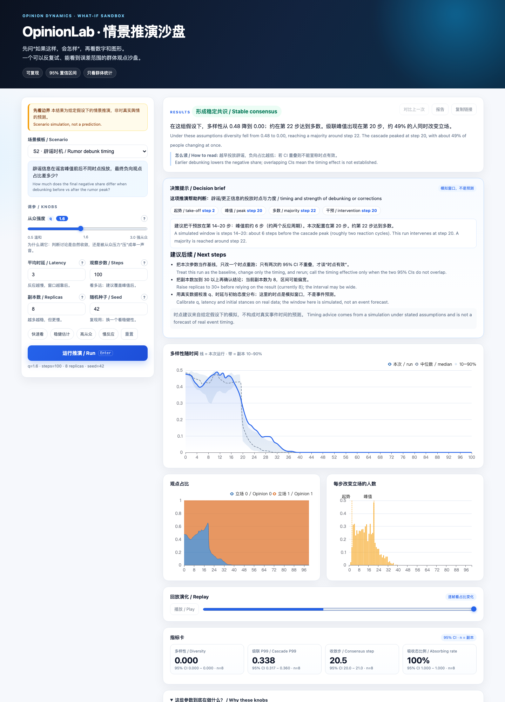

# 产品演示 / Demo application



OpinionLab 自带一个无需登录的浏览器演示页，用来快速体验“选场景 → 调参数 → 看演化 → 下载报告”的完整产品流程。

OpinionLab ships a public, no-login browser demo covering the full flow: choose a scenario, tune parameters, watch opinion dynamics, download a report.

## 在线版 / Live version

无需安装，直接打开：**https://cxy2696.github.io/opinionlab/**

页面在浏览器本地计算（二立场、均匀权重的轻量模拟），不上传数据；完整引擎、多立场、干预与报告请使用下方本地服务。

The hosted page computes locally in the browser (binary, uniform-weight lightweight simulation) and uploads nothing. Use the full service below for the complete engine, multi-opinion, interventions and reports.

## 本地启动 / Local run

```bash
make demo
# 打开 http://127.0.0.1:8000  →  自动跳转到 /api/v1/demo/app
```

演示页只依赖本仓库的引擎与静态资源，不需要 Postgres/Redis；完整服务（登录、场景库、作业队列）见 `docs/ARCHITECTURE.md`。

The demo only needs the engine and static assets; it does not require Postgres/Redis. The full service (auth, scenario library, job queue) is described in the architecture doc.

## 功能 / Features

- 15 个默认场景模板（S1–S9、G1–G4、G6、G7），显示中英双语“提问”
- 可调 `q`、平均时延、步数、副本数、随机种子
- **数形结合**：多样性曲线（本次运行 + 跨副本 10–90% 区间 + 中位数）、观点占比堆叠图、每步级联柱状图
- 一句话结论：自动写出“多样性从多少到多少、约第几步达到多数、级联峰值在第几步”
- **决策提示**：这项推演帮助判断什么、关键时点（起势/峰值/多数/干预）、建议的时机窗口，以及后续验证清单
- 指标卡片带 95% 置信区间（多样性、级联 P99、收敛步、吸收比例）
- 播放/拖动时间轴，逐帧看观点占比怎么变
- “对比上一次”按钮：同一组参数前后两次运行的差异，并标注置信区间是否重叠
- “复制参数链接”：URL 带上模板与参数，方便同事复现同一组推演
- “下载报告”：单文件离线 HTML（内嵌 ECharts、免责声明、CI 表、假设与局限）
- 所有输出仅群体统计量，不展示任何单节点轨迹

## API

| 方法 | 路径 | 说明 |
|---|---|---|
| GET | `/api/v1/demo/templates` | 可用模板与默认参数 |
| POST | `/api/v1/demo/simulate` | 运行一次小规模蒙特卡洛，返回指标 + 序列 |
| POST | `/api/v1/demo/report` | 生成单文件 HTML 报告 |
| GET | `/api/v1/demo/echarts.js` | 本地 ECharts bundle（离线可用） |
| GET | `/api/v1/demo/app` | 演示页 |

请求示例：

```bash
curl -s http://127.0.0.1:8000/api/v1/demo/simulate \
  -H 'Content-Type: application/json' \
  -d '{"template_key":"S2","q":1.8,"latency_mu":3,"repeats":8,"seed":42,"steps":120}'
```

## 决策提示与时机节点 / Decision brief and timing

每次运行会给出：

1. **这项推演帮助判断什么**：例如“辟谣/更正信息的投放时点与力度”。
2. **关键时点**：级联起势步、级联峰值步、达到多数的步、本次干预步。
3. **建议窗口**：例如“峰值前约两个反应周期（第 14–20 步）”，并注明本次配置落在哪一步。
4. **后续动作**：把本次当基线只改一个时点重跑、把副本加到 30+ 再确认、用真实数据校准参数。
5. **边界**：时点建议来自模拟，不是对真实事件时间的预测。

这些内容同时出现在演示页和下载的 HTML 报告里；图表上会用虚线标出多数、干预、峰值等节点。

The brief states what decision the run can inform, the key timing nodes (take-off, peak, majority, intervention), a simulated window, concrete next steps and a caveat. The same block is rendered in the demo and in the downloaded HTML report, with dashed markers on the charts.

## 图表怎么读 / How to read the charts

| 图 | 看什么 |
|---|---|
| 多样性 / Diversity | 实线是本次运行；虚线是多次副本的中位数；浅色带是 10–90% 区间。带越宽，说明结论越依赖随机性。 |
| 观点占比 / Opinion shares | 两种（或多种）立场的比例随步数变化；堆叠面积能看出“谁在什么时候占上风”。 |
| 级联 / Cascade | 每一步改变立场的人数比例；尖峰对应“突然转向”的时刻。 |

- 数字卡片上的 `n` 是参与聚合的副本数；`n<30` 时不要过度解读 CI。
- “收敛步”只统计**达到多数**的副本；没有副本达到多数时显示“无副本达到多数”。

## 分享与复现 / Sharing and reproduction

运行后地址栏会带上 `template/q/mu/steps/repeats/seed`。把链接发给同事，打开就是同一组参数；点“运行”即可复现。

The URL captures the template and parameters; sharing it reproduces the same setup.

## 运营 / Operating the demo

| 项 | 默认 | 说明 |
|---|---|---|
| `DEMO_MAX_NODES` | 400 | 公开演示的节点上限 |
| `DEMO_MAX_STEPS` | 200 | 步数上限 |
| `DEMO_MAX_REPEATS` | 20 | 副本上限 |
| 限流 | 全局 100 / IP 20 / 用户 30 / org 200 rps | 复用服务层令牌桶 |
| 观测 | `/metrics` | `opinionlab_api_duration_seconds` 等 |

- 演示接口不需要登录，因此**不落库、不持久化**；报告由浏览器现场生成。
- 想调整上限，改 `.env` 中的 `DEMO_MAX_*` 并重启 API。
- 静态资源拆成 `index.html` / `style.css` / `app.js`，方便单独维护；ECharts 由后端本地提供，不依赖 CDN。

## 边界 / Limits

为避免公开接口被滥用，演示模式主动限制：节点 ≤ 400、步数 ≤ 200、副本 ≤ 20，并且只允许启用状态的模板。完整产品没有这些限制，但需要登录与配额。

To keep the public endpoint safe, the demo caps nodes at 400, steps at 200 and replicas at 20, and only exposes enabled templates. The full product has no such caps but requires authentication and quotas.

## 适用场景 / Use cases

- 政策/公关团队做沟通节奏的前期假想推演
- 研究者快速体验模型对 `q`、时延与拓扑的敏感性
- 评审方在浏览器中核对“群体指标 + 置信区间 + 免责声明”的输出形态

- Early what-if exploration for policy/communications teams
- Quick sensitivity checks for researchers
- Reviewers inspecting group metrics, confidence intervals and disclaimers in a browser
