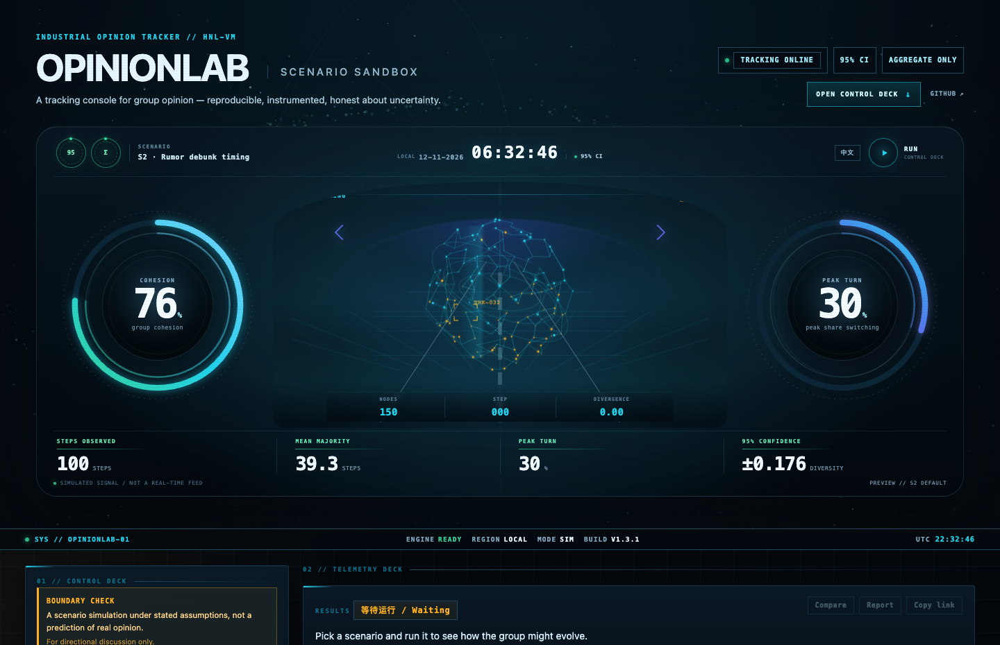

# Documentation

**Applies to:** OpinionLab v1.3.1 · [Repository README](../README.md) ·
[Changelog](../CHANGELOG.md)

The documents below describe the model, the engine, the service, the browser
demo and the boundaries of the product. They are written for different readers,
so the reading order matters more than the length.

*The v1.3.1 demo pairs a dashboard-style instrument cluster with the existing
cockpit controls and 3D telemetry. Start with [Demo](DEMO.md) for the interface
tour, or [Use cases](USE_CASES.md) for the questions it can help frame.*

## Where to start

- **New to the product:** read [Use cases](USE_CASES.md), then
  [Demo](DEMO.md), then [Model card](MODEL_CARD.md).
- **Checking the numbers:** read [Math model](MATH_MODEL.md) and
  [Conformance](CONFORMANCE.md). For a concrete input, read the
  [case study](CASE_STUDY.md).
- **Running or deploying the service:** read [Architecture](ARCHITECTURE.md),
  then [Runbook](RUNBOOK.md), then [Compliance](COMPLIANCE.md) and
  [Capacity](capacity-report.md). For offline delivery, use the
  [air-gapped guide](../deploy/private/OFFLINE.md).
- **Running the examples:** use the [examples index](../examples/README.md)
  and the [data sample README](../data/README.md).

## All documents

| Document | Contents |
|---|---|
| [Use cases](USE_CASES.md) | Six worked questions, exact commands and interpretation |
| [Demo](DEMO.md) | Hosted and local interfaces, instrument cluster, API, limits, Ollama |
| [Architecture](ARCHITECTURE.md) | Layers, data flow, module map and web asset pipeline |
| [Math model](MATH_MODEL.md) | Formulas, `q` limits, estimators and failure boundaries |
| [Case study](CASE_STUDY.md) | A published hashtag sample, from CSV to component result |
| [Conformance](CONFORMANCE.md) | Equation-to-code map and the shared numerical fixture |
| [Model card](MODEL_CARD.md) | Capabilities, limits and prohibited uses |
| [Compliance](COMPLIANCE.md) | Regions, review, deletion, retention and red lines |
| [Runbook](RUNBOOK.md) | Metrics, logs, troubleshooting, canary, rollback and tainted runs |
| [Capacity](capacity-report.md) | Formula, calibration, load scenarios and alert pass lines |
| [Changelog](../CHANGELOG.md) | Behaviour changes, UI releases and known deviations |
| [Data sample](../data/README.md) | Kaggle source, SHA-256, licensing and interpretation limits |
| [Examples](../examples/README.md) | Two minimal scripts plus the real-data case |
| [Air-gapped delivery](../deploy/private/OFFLINE.md) | Offline install, verification and rollback |
| [Repository README](../README.md) | Product summary, quick start and repository map |

## Conventions

- Every page starts with the release it applies to and links back to this index
  and the changelog.
- The repository documentation is English-only. The browser demo still offers
  an optional Chinese interface translation for end users; that is a UI
  feature, not a second set of documentation.
- Commands assume the repository root unless a document says otherwise.
- `runs/`, `datasets/` and downloaded reports are local artifacts; they are not
  committed.
- Every published report must keep the fixed disclaimer. Individual-level
  predictions, profiles and traces are outside the product contract; see
  [Compliance](COMPLIANCE.md) and [Model card](MODEL_CARD.md).

## Screenshots

The current screenshots are generated from v1.3.1 and are tracked in this
directory:

- [`demo.png`](demo.png): hosted and local demo, initial instrument-cluster state.
- [`telemetry-3d.png`](telemetry-3d.png): the 3D telemetry deck after a run.

For the source-vs-generated ownership rules, see the Repository map in the
[README](../README.md#repository-map).
